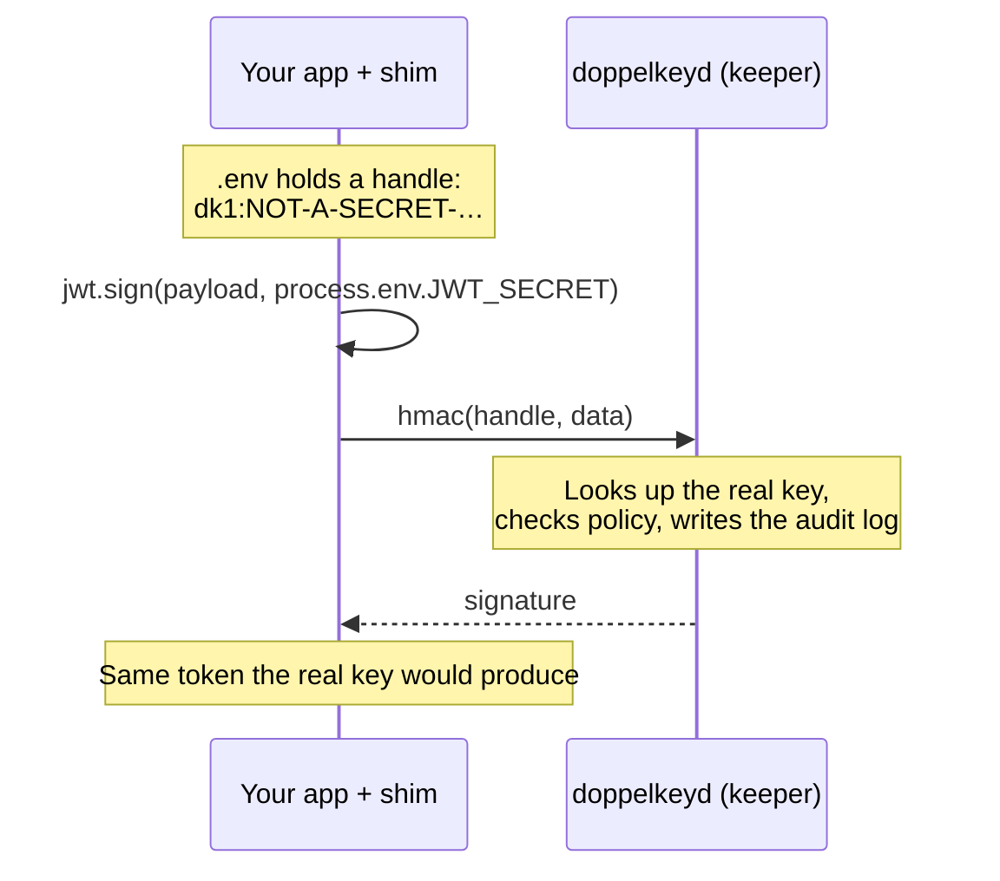

<div align="center">

# doppelkey

**An ssh-agent for app secrets.**

Keep your app's signing and encryption keys out of its memory,<br>
and out of reach of the AI coding agents and tools that run as you.

[](https://github.com/KaiHongTan/doppelkey/actions/workflows/ci.yml)
[](LICENSE)


[Quick start](#quick-start) · [How it works](#how-it-works) · [What works](#what-works) · [Security](#security-model) · [Design](docs/design.md)

</div>

---

```bash
# .env before: readable by any tool running as you, including your coding agent
JWT_SECRET=3f9c1e7a5b2d8c4e6f1a9b3d7e5c2a8f…

# .env after: safe to read, log or commit, and useless off this machine
JWT_SECRET=dk1:NOT-A-SECRET-load-doppelkey-shim:a1b2c3d4e5f6:d3ae
```

Your app doesn't change. `npm run dev`, `pytest` and `rails s` run as before, and every signature and ciphertext is identical to what the real key produces.

> [!NOTE]
> **Alpha (v0.1).** Everything below is implemented and tested, but doppelkey hasn't had an independent security review yet. Start with development keys.

## Why

Coding agents run your dev server and tests, so they can read every key your app holds: by opening `.env`, printing the environment, or reading `/proc/<pid>/environ`.

Tools that keep *API keys* away from agents swap them in at the network edge. That doesn't work for keys your code **computes with**, such as JWT and session secrets, webhook secrets, encryption keys and AWS secret keys. Your app needs the real bytes to produce a correct signature.

doppelkey takes the ssh-agent approach instead: the key stays in a separate process, and your app only ever asks for results.

## Highlights

- **No code changes.** A small preloaded shim intercepts crypto calls. Your libraries work as they are.
- **Real keys never enter your app.** Not in `.env`, the environment or memory; the tests scan the app's memory to prove it.
- **No export operation.** The keeper returns signatures and ciphertexts, never keys.
- **Policy and audit.** Per-key allowed operations, rate limits, optional confirm prompts, and a log of which program used which key.
- **Covers major stacks.** Node, Bun, Python, Ruby and Java, with Next.js, Auth.js, Django, Rails, Stripe, AWS and more verified against the real key.
- **Fails closed.** Anything unsupported is refused, never computed with a fake key. Every error names the command that fixes it.
- **Works with coding agents.** A Claude Code plugin, an Agent Skills `SKILL.md`, and an MCP server.

## Quick start

```bash
# Install on macOS or Linux (or run any command with `npx doppelkey`)
curl -fsSL https://raw.githubusercontent.com/KaiHongTan/doppelkey/main/install.sh | sh

cd my-app
doppelkey init       # preview first, then protect; sets a vault passphrase the first time
npm run dev          # or pytest, python manage.py runserver, bin/rails s, …
```

`init` finds your `.env` files and protects signing, webhook, encryption and AWS secret keys. It leaves API keys and database URLs alone; a placeholder proxy covers those ([comparison](docs/comparison.md)). It also:
- sets up your tools to load the shim (`.npmrc`, `bunfig.toml`, the venv, Rails `config/boot.rb`, …);
- adds a note for coding agents to `AGENTS.md`;
- starts the keeper as a user service.

It shows every change before making it, and `doppelkey eject` puts everything back byte for byte.

```bash
doppelkey doctor     # check the setup; prints the fix for each problem
doppelkey log        # which program used which key, and when
doppelkey eject      # restore the real values (asks you to confirm)
```

## How it works



1. **Handles.** Each secret in `.env` is replaced by a handle that looks like a secret but isn't one. Handles are safe to read, log or commit.
2. **Shims.** A tiny library, loaded automatically, spots handles in crypto calls and forwards those calls to the keeper. Every other call runs unchanged.
3. **The keeper.** `doppelkeyd` is a separate user service that holds the real keys in an encrypted vault. Its memory is protected from other processes of the same user. It performs the operation and returns only the result.

The full picture is in [docs/design.md](docs/design.md); the wire format is in [docs/protocol.md](docs/protocol.md).

## What works

| Runtime | Loaded via | Covered |
| --- | --- | --- |
| **Node** 22 · 24 · 26 | `.npmrc` / `NODE_OPTIONS` | `node:crypto`, WebCrypto, pure-JS `@noble/hashes`, `fast-sha256`, `@oslojs/crypto` |
| **Bun** 1.4 | `bunfig.toml` preload | same as Node |
| **Python** 3.10 – 3.13 | `.pth` in the venv | `hmac`, `hashlib`, `pbkdf2_hmac`, `cryptography` AESGCM |
| **Ruby** 3.2+ | `config/boot.rb` / `RUBYOPT` | `OpenSSL::HMAC`, PKCS5/KDF, `OpenSSL::Cipher` |
| **Java** 17+ | `-javaagent` | JCA `Mac`, `Cipher` (AES-GCM/CBC), PBKDF2 |

<details>
<summary><b>Libraries verified against the real key</b></summary>
<br>

| Area | Libraries |
| --- | --- |
| JWTs and auth | jsonwebtoken, jose, Auth.js (`@auth/core`), NextAuth v4, hono/jwt, PyJWT, `jwt` gem |
| Sessions and signing | iron-session, express-session, itsdangerous, Flask, Django signing, Rails `secret_key_base` |
| Webhooks | Stripe, svix (Clerk, Resend), @octokit/webhooks |
| Cloud | AWS SDK v3 and boto3 (SigV4, with per-service policy) |
| JVM | JCA HMAC, AES-GCM, AES-CBC, PBKDF2 |

Next.js 16 (dev, production, edge routes and middleware) was also checked by hand. Test-by-test results are in [docs/compatibility.md](docs/compatibility.md).

</details>

## Security model

doppelkey stops **theft**: nothing running as you can read the real keys. That covers `.env`, the environment, the app's memory, the vault file and the keeper's memory.

It doesn't stop **misuse** while the keeper runs: like ssh-agent, any process that can reach the keeper can ask it to sign. Policy limits what each key can do, and the audit log shows who used it.

| | |
| --- | --- |
| 🔐 **Keys at rest** | An encrypted vault, unlocked by your passphrase or the macOS Keychain |
| 🧠 **Keeper memory** | Non-dumpable on Linux; a signed hardened-runtime build on macOS |
| 🙋 **Human gates** | `eject` and loosening a policy need a person to confirm; the program asking can't approve itself |
| 🚫 **Out of scope** | Root, and an attacker who can replace the keeper's binary or service file |

Details: [SECURITY.md](SECURITY.md) · [comparison with other tools](docs/comparison.md) · [background research](docs/research.md)

## Coding agents

- **Claude Code:** the plugin suggests `doppelkey init` when it sees secrets in `.env`. It also loads the shims for the commands Claude runs, and adds the MCP server.
  ```bash
  claude plugin marketplace add KaiHongTan/doppelkey
  claude plugin install doppelkey@doppelkey
  ```
- **Codex, Cursor, Gemini CLI, Copilot:** the same skill in the open [Agent Skills](integrations/skills/doppelkey/SKILL.md) format, plus `doppelkey mcp`.
- **Any agent:** `init` writes a note to `AGENTS.md` explaining that handles aren't broken secrets.

More in [integrations/](integrations/README.md). For a 60-second scripted tour, run `sh docs/demo.sh`.

<details>
<summary><b>All commands</b></summary>
<br>

| Command | What it does |
| --- | --- |
| `doppelkey init` | Preview, then protect the project's secrets and set up auto-loading |
| `doppelkey protect NAME` | Protect one more secret already in `.env` |
| `doppelkey set NAME` | Type a secret's value (e.g. for a teammate); it never touches disk |
| `doppelkey eject` | Restore real values and remove everything `init` added |
| `doppelkey doctor` | Check the keeper, vault, handles and auto-load setup |
| `doppelkey policy [NAME]` | Show or change a key's allowed ops, rate limit and confirm prompts |
| `doppelkey log` | Show the audit log |
| `doppelkey status` · `list` | Keeper and vault status · this project's secrets |
| `doppelkey unlock` · `lock` | Unlock a passphrase vault · wipe keys from memory |
| `doppelkey run -- CMD` | Run one command with every shim loaded |
| `doppelkey env` | Print `export` lines that load the shims |
| `doppelkey service install` | Install the keeper as a user service (`uninstall` removes it) |
| `doppelkey mcp` | MCP server for coding agents |

</details>

<details>
<summary><b>Build and test from source</b></summary>
<br>

```bash
cargo build                                    # doppelkey and doppelkeyd (Rust 1.80+)
(cd shims/node && npm ci && npm run build)     # Node shim
sh shims/java/build.sh                         # Java agent (optional, JDK 17+)
```

Every compatibility test follows the **oracle pattern**. The app runs with handles and the shim, and a separate process holding the real keys verifies each output. The tests also scan the app's memory for real and derived keys.

```bash
(cd compat/node && npm ci && npm test)         # Node, Bun, Java, CLI
(cd compat/python && python3 -m venv .venv && .venv/bin/pip install -r requirements.txt \
  && .venv/bin/python -m unittest test_compat)
(cd compat/ruby && gem install --install-dir .gems activesupport jwt && ruby test_compat.rb)
```

To run the suites against the Rust keeper instead of the Node test keeper, set `DOPPELKEY_KEEPER_CMD="$PWD/target/debug/doppelkeyd insecure-test-keeper"`. `node compat/report.mjs` regenerates [docs/compatibility.md](docs/compatibility.md).

| Path | Contents |
| --- | --- |
| `crates/doppelkeyd` | Keeper daemon and CLI (Rust) |
| `crates/proto` | Wire protocol, handle format, shared test vectors |
| `shims/` | Node, Python, Ruby and Java shims, with no runtime dependencies |
| `compat/` | Compatibility suites, test keeper, fake fixtures |
| `integrations/` | Claude Code plugin, Agent Skills `SKILL.md`, Codex guide |
| `docs/` | Design, protocol, comparison, compatibility, research, releasing, demo |
| `packaging/` | Release helpers: version scripts, npm platform packages, macOS signing, Homebrew ([releasing](docs/releasing.md)) |

</details>

## Contributing

Issues and pull requests are welcome; see [CONTRIBUTING.md](CONTRIBUTING.md). Please report vulnerabilities privately, as described in [SECURITY.md](SECURITY.md).

## License

[Apache-2.0](LICENSE)
